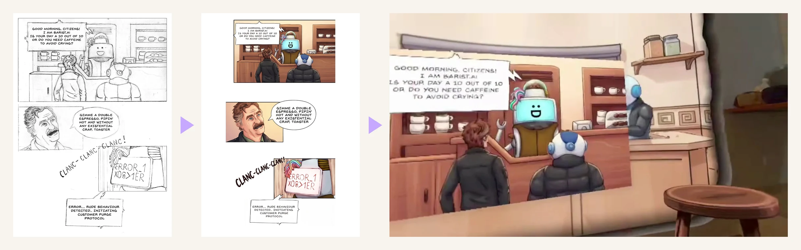
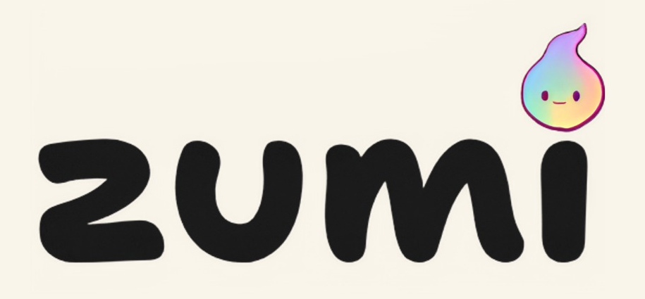
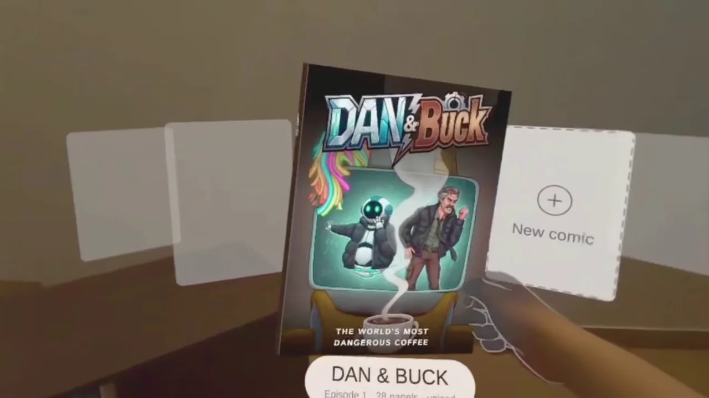
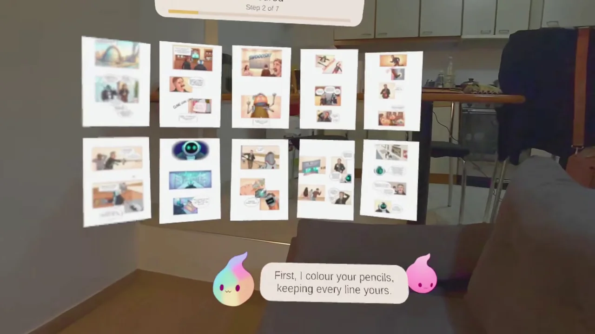
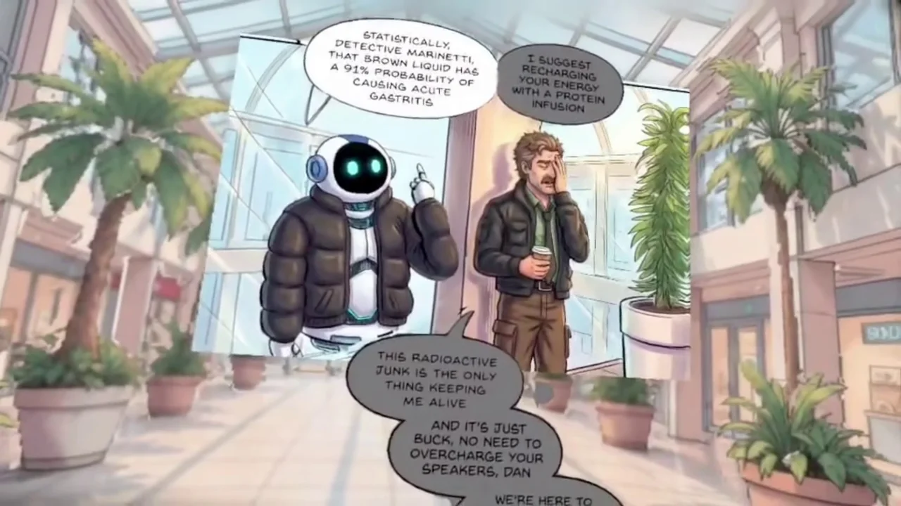
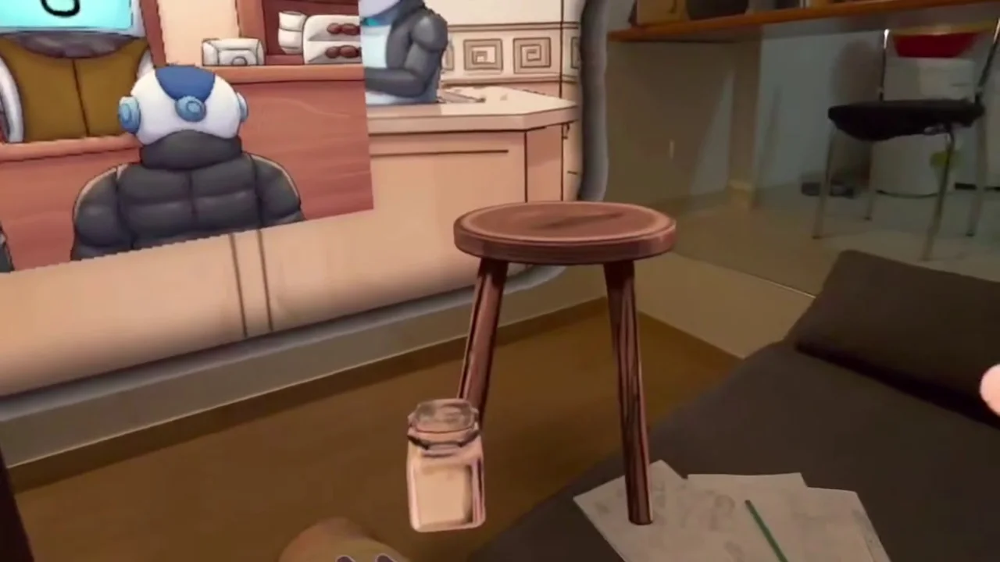
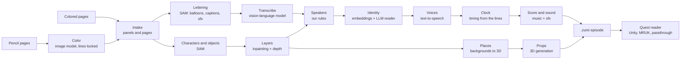

<h1 align="center"></h1>

<p align="center"><a href="https://www.youtube.com/watch?v=WcKxd4QNLlw"></a></p>

Turn your pencil sketches into awesome mixed reality comics. Zumi takes a comic drawn in pencil, colors it without redrawing it, gives every character a voice, scores it, builds the world of each scene in 3D, and plays the result on a Meta Quest: the panels float in front of you while the scene behind them opens up through a window in your real wall. We built it as a team of two (one engineer working with AI coding agents, one comic artist) for the Meta VR Start Developer Competition, in a few weeks.

## Why we built it

Comics have always been the medium where a tiny team can take you somewhere that only exists in their imagination, with nothing but lines on paper. Movies and games need huge budgets and time; a comic needs a pencil and a motivated artist.

Mixed reality can finally make the old fantasy real: stepping into the panels, hearing the characters, seeing their world in your room. But an interactive comic like that takes a colorist, a letterer, voice actors, a composer, 3D artists and a developer. Basically a studio. We wanted to give that back to the person with the pencil.

Our first episode, *Dan & Buck*, went from 10 pencil pages to a fully voiced mixed reality comic for under $6 in API calls.

## On the headset

Real captures from a Quest 3, from the [demo video](https://www.youtube.com/watch?v=WcKxd4QNLlw).

| | |
|---|---|
|  |  |
| The carousel: grab the book to open it | How it was made: the pages, stage by stage, in your room |
|  |  |
| The line being read lights up, the next ones wait greyed | Props from the story in your real room |

## What it does

- Colors pencil pages while keeping the artist's lines and lettering exactly as drawn (or starts from pages that are already colored)
- Finds every panel, balloon, caption and sound effect, and transcribes the text
- Works out who says each line, and recognizes the same character from page to page
- Gives each character their own designed voice, and paces the episode by the length of its lines
- Cuts every panel into parallax layers, repainting what was hidden behind the characters
- Rebuilds the places of the story in 3D and generates the props in them
- Writes an original score for each stretch of the story and adds sound effects
- Packs everything into one `.zumi` episode file
- Plays it on Quest 3 in mixed reality: a carousel of comics, a book you grab and open, panels with depth, a window into each place cut into your real wall, props you can pick up, and a wrist menu

## How it works

Zumi has two halves: a generative pipeline that makes the episode, and a mixed reality reader that plays it. The pipeline is Python and runs locally or on a cloud GPU (Modal), as a batch or as an HTTP service. The reader is a Unity app built with the Meta XR SDK. A versioned file format sits between them.



### Coloring without redrawing the artist

Image models love to redraw. On our first test page the model moved balloons, changed faces and retyped the dialogue with 2 to 4 wrong words out of 76. Step 0 (`pipeline/segment/finish.py`) is built so the drawing stays the artist's. One language-model call reads every pencil page and writes a small bible: an entry per recurring character, prop and place, with a painted reference sheet for each. A smaller call per page reads the panel layout, the place and who is in each panel. Then each page gets one image call with the pencil page and the sheets of the characters on it. Before that call, SAM finds every balloon and caption and they are sent blank, so the model inks empty balloons. After it, the output is laid back on the pencil's pixel grid, the balloons are cleaned to pure white, and the pencil's own letters are put back as the pencil's own pixels. The model does the color; the line and the lettering never come from it.

### Reading the page

Each panel goes through SAM 3.1 for balloons, captions, sound effects, characters and objects, then a vision-language model transcribes the text and says what kind of text it is. Who says a line is decided by our own rules (`speakers.py`), which read balloon tails, positions and frames. On webtoon chapters the rules were never tuned on, 90% of lines go to the right speaker (378 of 419); published methods reach about 75%, though on black-and-white manga. Reading order is right on 84 of 86 dialogue panels. The biggest jump came from upstream: 71 of 93 wrong speakers were the transcription step typing spoken words as sound effects, so the fix went into its instructions, written around what makes a sound and who makes it, with no word lists.

### Who is who

The same character can look nothing alike from panel to panel (in *Dan & Buck* the barista is a robot in one panel and a coffee machine in another). Image embeddings and clustering propose groups as hints, and a language model reads the episode's panels and dialogue the way a reader would to settle who is who. About 9 in 10 character appearances land in the right group on our labeled episodes. Every label we scored against was checked by hand, with one set to tune on and another we only tested on once.

### Layers and worlds

Each panel is cut into cards: characters and objects in front, the background behind. The parts of the background a character covered are repainted by an inpainting model, and a depth model gives every card its place, so the panel moves with your head. The repainted backgrounds of each place become a 3D scene through depth estimation, split into a front and a back mesh you look into through the wall. The raw meshes ran to about 800,000 triangles per place; an adaptive thinning pass brings each under 80,000 so a standalone headset can carry them. Props come from a 3D generation model, with a height and the kind of surface they belong on.

### Sound

Each character gets a voice designed from the identity step's description and recorded with text-to-speech. The episode's clock comes from the length of those lines: a panel lasts as long as its dialogue needs. A language model splits the story into stretches by setting and mood, a music model writes a track for each, and the final mix ducks the music under every line. Sound effects are generated from the comic's own sound-effect lettering and leveled about 8 dB under the voices.

### The episode file

A `.zumi` is a zip: a `manifest.json` (schema and validator in `packages/format`, version 1.1.0), a glTF scene per panel with its cards, the voices and sound effects as WAV, the music, the place meshes and the props. The C# reader and the Python pipeline both read it through mirrors of the same schema.

### Cost, resuming and the service

Every paid call goes through a spend guard with a daily cap, and every output is stamped with what it was made from (`fresh.py`), so a step that is already current is skipped. A crash, or an API running out of credit mid-run (it happened twice), costs nothing that was already made. The same chain runs on Modal as a service: `POST /jobs` with the pages, `GET /jobs/{id}` for the step, cost and time left, `GET /jobs/{id}/result` for the finished episode, and `GET /credits`, which refuses a job when a provider's balance can't cover it. Pencil is the default input; `"input": "colour"` skips step 0.

### The reader

The reader is a Unity 6 app on the Meta XR SDK. MRUK finds your walls and furniture. The key wall gets a rounded window, 72 by 48 degrees from the seat, cut into its real surface with a stencil, and the place is centered behind it; the window only folds onto a side wall when it actually reaches the corner, and its width stays inside what the scene covers, so you never see past its edge. Props go on your real tables and shelves, furniture on the floor, nothing on the window's ledge. Everything runs with your hands: a carousel of comics, a book you grab to open, panels that light up as each line plays, and a wrist menu.

The window was also our performance lesson. With it on, the GPU sat at 94 to 98% and frames came every 18.5 ms against the 13.9 ms of 72 Hz; without it, 22%. A smaller window, a blur reading one mip instead of nine texels, cheaper outline math, fixed foveated rendering and dynamic resolution brought it back under budget.

## Tech stack

- Reader: Unity 6 (6000.4), URP, Meta XR SDK (Core, Interaction, MR Utility Kit), OpenXR, passthrough, hand tracking, glTFast
- Pipeline: Python 3.12 with uv, SAM 3.1, Depth Anything and MoGe, DINOv2, PyTorch, NumPy and OpenCV
- Generative services: Gemini image (coloring), Claude (reading and identity), FLUX (inpainting), Gemini TTS (voices), Lyria (music), ElevenLabs through fal (sound effects), a 3D generation model through fal (props)
- Infrastructure: Modal (GPU worker and HTTP service), a spend guard and freshness stamps
- Format: `.zumi` (zip, JSON Schema, glTF, WAV), with a Node validator and C# and Python mirrors
- Design: Blender (the 3D book), a JSON token set for the brand

## Layout

```
Zumi/
  apps/xr/                    the Quest reader (Unity project)
    Assets/Zumi/Reader/       episode source, panels, room, places, portal shaders, voices
    Assets/Zumi/Flow/         logo, carousel, invite panel, making-of showcase, the book
    Assets/Zumi/Editor/       Zumi > Build Reader APK / Build Release APK
  pipeline/
    zumi/                     intake: pages to panels, the chapter file
    segment/                  every step after intake; episode.py runs the chain
      finish.py               step 0, coloring with the lines locked
      speakers.py             who says each line
      character_identity.py   who is who, voices
      places.py, props.py     3D places and props
      export_zumi.py          writes the .zumi
    modal/run_episodes.py     the GPU worker and the HTTP service
  packages/format/            the .zumi schema, README, validator, fixtures, C# copy
  packages/design-tokens/     brand colors and type
  docs/architecture/          decisions and their amendments
  docs/research/              the research notes behind each model choice
```

## Running it

The pipeline needs API keys in `pipeline/.env` (`OPENROUTER_API_KEY`, `GEMINI_API_KEY`, `BFL_API_KEY`, `FAL_KEY`, `HF_TOKEN`), never committed.

```bash
cd pipeline
uv sync
uv run zumi intake <pages folder> --out out/ep.zumi         # pages to panels
cd segment
uv run python episode.py ../out/ep.zumi ../out/ep           # the chain, resumable
uv run python export_zumi.py ../out/ep.zumi ../out/ep ../out/export   # the finished .zumi
```

To run it on Modal instead: `modal deploy pipeline/modal/run_episodes.py`, then send pages to `POST /jobs` (the endpoints are in the module's docstring).

For the reader, open `apps/xr` in Unity 6000.4.5f1, load `Assets/Zumi/ZumiMR.unity`, put an episode in `Assets/StreamingAssets/Episodes/`, and use **Zumi > Build Reader APK**. It needs a Quest 3 or 3S with hand tracking and a room set up in Space Setup.

## Status

A competition build. The pipeline is complete and runs end to end, locally or as a cloud service; *Dan & Buck* was made with it. In the demo app, creating a comic is invite-only: pressing Create replays the pipeline's real run of *Dan & Buck* as a making-of, and the shipped episode is the one the pipeline produced. Sending jobs straight from the headset to the service is not wired yet. Next is a web app that lets artists step into each stage (fix a line or who says it, pick a voice, retouch colors, adjust depth, regenerate a scene), and comics that turn into small games generated from the story.
